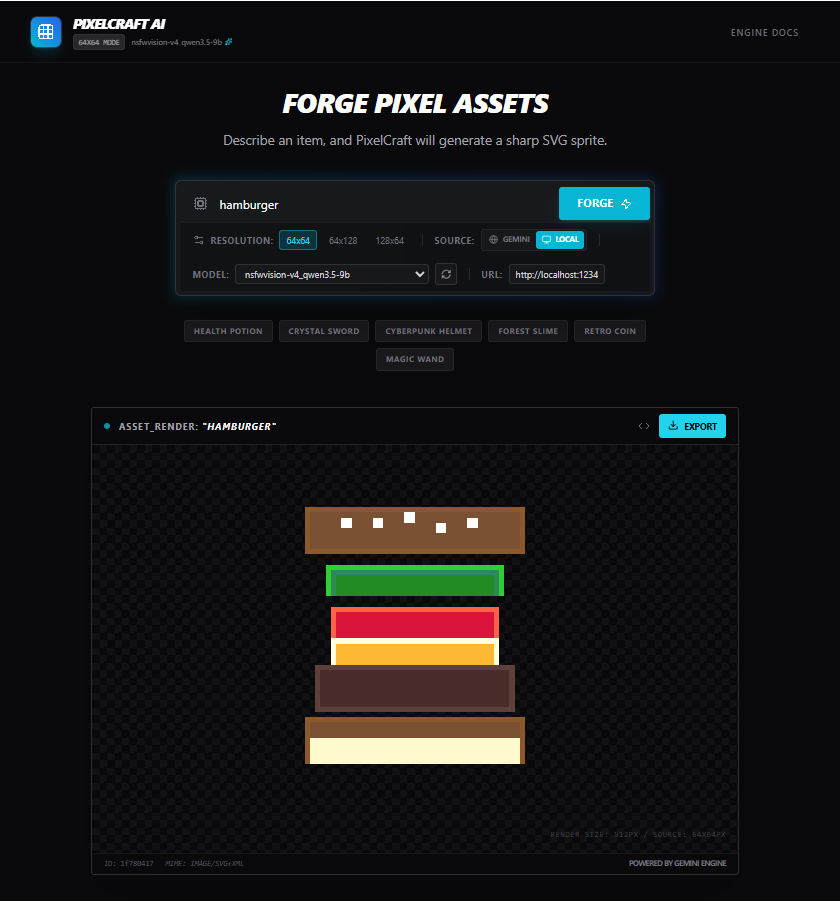
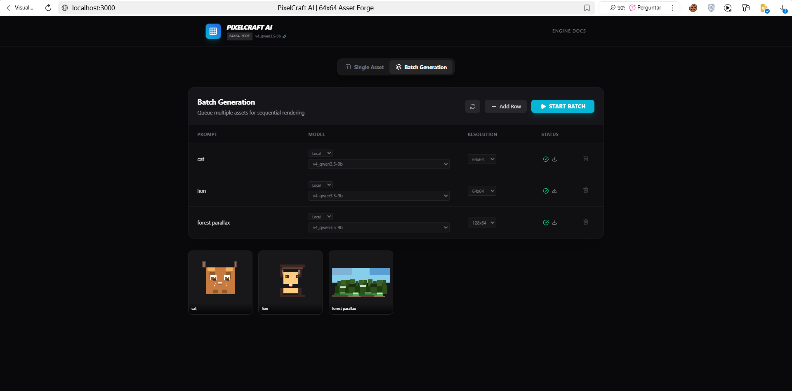

# 🎨 SVG Pixel Art Generator (PixelCraft AI) — v2.0.0

A web application and headless CLI engine to **generate, remix, validate, and export pixel art in crisp SVG & PNG formats using AI**, supporting local OpenAI-compatible servers, **BeaverNet**, and **Google Gemini** with live dynamic model discovery.

---

## 🚀 What's New in v2.0.0

* **🔍 Dynamic Model Discovery (No Baked Model Names):** Available models are queried live from each provider's API (`/v1/models` or Gemini `/v1beta/models`), ensuring the app never attempts to call a non-existent model.
* **🦫 BeaverNet Integration:** Native support for [BeaverNet](https://net.beaverai.org/v1) — a community pool of LLM compute where people with spare GPUs serve models through one OpenAI-compatible API.
* **✨ Edit / Remix Tab:** Upload (drag-and-drop) or paste one or more existing `.svg` files and instruct the AI to modify, fuse, recolor, add gear, or generate new poses/animation frames — without fixed resolution constraints (`Auto` preserves original `viewBox`) and with full access to all preview transformations.
* **📚 In-App Engine Docs & Secure `.env` Key Manager:** Clicking **Engine Docs** opens the application's own documentation and API key settings. Keys are tested live before saving to `.env`, cleared from the input field immediately after saving, shown with a **"Chave salva"** status badge, and can be deleted at any time.
* **🖥️ Full Headless Mode (CLI):** Run automated bulk generations, SVG validation, sprite sheet & compare sheet rendering directly in Node.js without a browser (`--source local | beavernet | gemini | mock`).
* **🎨 Post-Processing & Export Suite:** Retro palette remapping, nearest-neighbor `1x` & `8x` PNG export, SVG export, Aseprite-compatible Sprite Sheets (`.png` + `.json`), Compare Sheets, backdrops (`none`, `dark`, `ground`), pivot/origin markers, and `<g id="light">` cubic `edgeFade`.
* **🌐 LAN / Non-Secure HTTP Compatibility:** Safe UUID generation fallback so the UI loads reliably over local network IPs (e.g. `http://192.168.x.x:3000`).

---

## 🧩 Core Modes

### 1. Single Asset Mode
Generate individual pixel art sprites in `64x64`, `64x128`, or `128x64` with structured `<g id="color">` and `<g id="light">` layers, automatic integer-coordinate sanitization, and instant palette/export tools.



### 2. Batch Generation Mode
Queue multiple prompts with independent provider, model, and resolution settings per row. Export all generated sprites as **Aseprite-compatible Sprite Sheets (`.png` + `.json`)** or **Compare Sheets**.

<div align="center">
  
</div>

### 3. Edit / Remix Mode
* Drag-and-drop multiple `.svg` files or paste raw SVG code.
* Write modification or fusion instructions (with quick presets).
* Keep original dimensions (`Auto`) or target `64x64`, `64x128`, or `128x64`.
* Chain edits using **"Usar Último Resultado"** and apply all preview transformations (palette swap, backdrops, `edgeFade`, PNG `1x`/`8x` & SVG export).

---

## 🤖 Supported AI Providers

| Provider | Endpoint | Environment Variable | Notes |
| :--- | :--- | :--- | :--- |
| **OpenAI / Local** | `http://127.0.0.1:1234` (configurable) | `OPENAI_API_KEY` *(optional)* | LM Studio, llama.cpp, Ollama, vLLM, LocalAI |
| **BeaverNet** | `https://net.beaverai.org/v1` | `BEAVERNET_API_KEY` | Community GPU pool via OpenAI-compatible API |
| **Google Gemini** | `https://generativelanguage.googleapis.com/v1beta` | `GEMINI_API_KEY` | Live model listing via Gemini API |

---

## ▶️ Run Locally

### Prerequisites
* **Node.js** 22+ (native TypeScript execution for CLI & tests)

### 1. Install dependencies
```bash
npm install
```

### 2. Start the application
```bash
npm run dev
```
Open `http://localhost:3000/` in your browser (or your machine's LAN IP on port `3000`).

### 3. Configure API Keys (Optional for Local Servers)
1. Click **Engine Docs** in the top-right corner of the app.
2. Open the **Chaves de API (.env)** tab.
3. Paste your key for **BeaverNet**, **Google Gemini**, or **OpenAI / Local** and click **Testar & Salvar**.
   * The server validates the connection live, writes the key to `.env`, clears the text input, and displays **Chave salva**.
   * You can remove any saved key at any time using **Apagar chave**.

*(Alternatively, you can configure `.env` manually with `BEAVERNET_API_KEY`, `GEMINI_API_KEY`, and/or `OPENAI_API_KEY`.)*

---

## 💻 Headless Mode (CLI & Automation)

The engine runs 100% headless in Node.js (reading `.env` automatically and querying live models from the selected provider):

```bash
# Auto-detect local OpenAI-compatible server (LM Studio, llama.cpp, Ollama)
npm run bulk -- --limit 3

# Generate using BeaverNet (https://net.beaverai.org/v1)
npm run bulk -- --source beavernet --limit 3

# Generate using Google Gemini (live model discovery)
npm run bulk -- --source gemini --limit 3

# Offline procedural mock test (no external API calls)
npm run bulk -- --source mock --limit 2

# Custom prompt file & concurrency
npm run bulk -- --input my-prompts.txt --concurrency 2
```

### Running Tests & Build
```bash
# Run unit tests
npm test

# Production build
npm run build
```

---

## 🛠️ Tech Stack
* **React 19 + TypeScript + Vite 6**
* **Vite Middleware API** (`server/envApiPlugin.ts`) for `.env` key management and CORS-free provider proxying
* **Headless Rasterizer & PNG Encoder** (`tools/lib/headlessCanvas.ts`, `utils/rasterizer.ts`)
* **SVG Validator & Auto-Sanitizer** (`utils/svgChecker.ts`)

---

## 🙏 Agradecimentos

**Agradecimentos à comunidade BeaverNet / BeaverAI:** agradecemos ao [BeaverNet](https://net.beaverai.org) e a todos os provedores comunitários que disponibilizam modelos abertos gratuitamente para a comunidade através da API aberta ([docs](https://net.beaverai.org/docs/platform/overview)).
